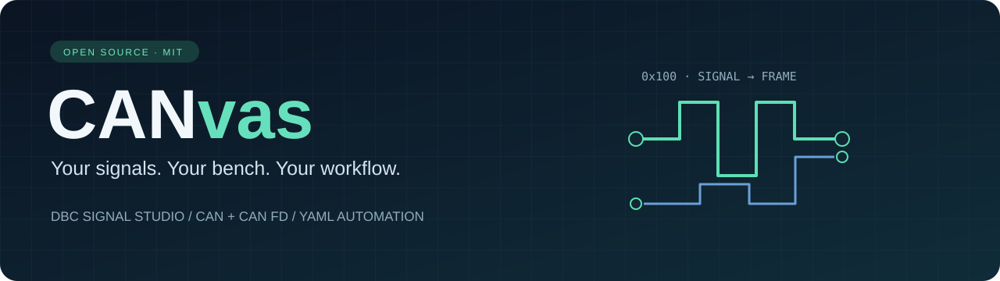
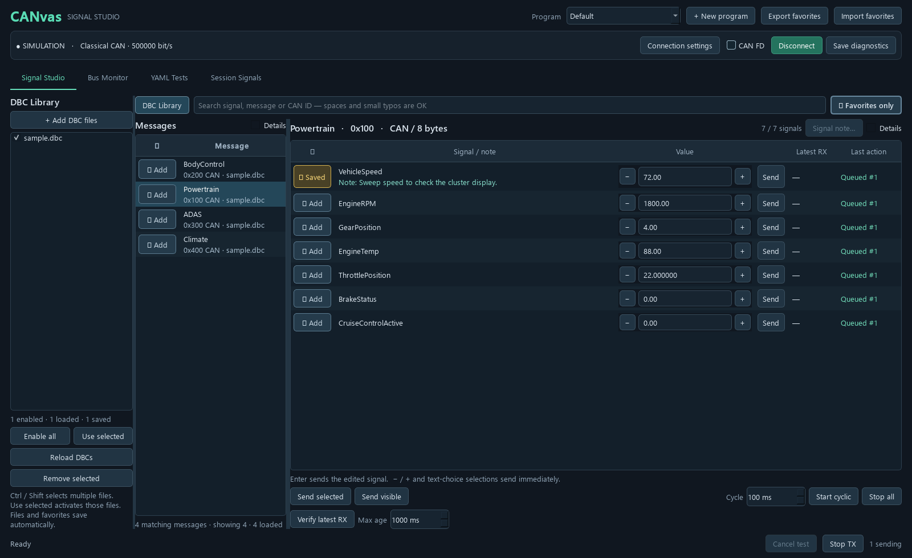

<p align="center">
  
</p>

<h1 align="center">CAN &amp; CAN FD bench testing, made approachable.</h1>

<p align="center">
  Explore DBC signals. Control live traffic. Turn repeatable HMI checks into code.<br>
  <strong>A native desktop workspace, a local browser UI, and a scriptable CLI.</strong>
</p>

<p align="center">
  <a href="https://github.com/Aravindraj93/CANvas/actions/workflows/ci.yml"></a>
  <a href="LICENSE"></a>
  <a href="pyproject.toml"></a>
  <a href="RELEASE_CHECKLIST.md"></a>
</p>

<p align="center">
  <a href="#get-started"><strong>Get started</strong></a> ·
  <a href="#see-it-in-action"><strong>See the app</strong></a> ·
  <a href="docs/writing-tests.md">Write scenarios</a> ·
  <a href="BENCH_SETUP.md">Connect your bench</a> ·
  <a href="CONTRIBUTING.md">Contribute</a>
</p>

---

## From a DBC file to a repeatable bench workflow

CANvas helps automotive developers and test engineers work with meaningful signal values instead of manually assembling payload bytes. Bring your DBCs, organize a program, send signals, inspect traffic, and automate checks with readable YAML and HTML results.

**Start without hardware.** Explore with a virtual CAN bus and the included synthetic DBC, then configure an adapter for your isolated development bench.

## See it in action

<p align="center">
  
</p>

<p align="center"><sub>Native desktop Signal Studio · Included synthetic sample DBC · Virtual CAN demonstration</sub></p>

## Built for the work on your bench

<table>
<tr>
<td width="50%" valign="top">

### 🗂️ DBC Signal Studio

Browse messages and signals side by side. Search names and CAN IDs, edit physical values, and use named choices where the DBC defines them. Load multiple databases and organize them by program.

</td>
<td width="50%" valign="top">

### 🎛️ Manual & cyclic control

Send a signal or a message, adjust values with numeric controls, and repeat full CAN messages at a chosen interval. Keep your frequent signals close with favorites and per-program notes.

</td>
</tr>
<tr>
<td valign="top">

### 📡 Traffic & session visibility

Monitor CAN traffic and inspect successfully transmitted session signals, encoded values, TX counts, and cycle status. Keep draft edits separate from the last transmitted value.

</td>
<td valign="top">

### 🧪 Readable test automation

Write YAML scenarios for sends, waits, fresh received-signal assertions, and visual comparisons with prepared baselines. Run from the desktop, browser, or CLI and cancel execution when needed.

</td>
</tr>
<tr>
<td valign="top">

### 📋 Results you can review

Generate HTML reports with verdicts, step details, and durations. Distinguish PASS, FAIL, ERROR, INCOMPLETE, and CANCELLED. Scenarios without verification do not get a passing verdict.

</td>
<td valign="top">

### ✨ Optional AI assistance

Draft YAML with Gemini when configured, or use local templates without a key. Review every generated scenario before running it. Gemini use discloses prompts and DBC-derived metadata to Google.

</td>
</tr>
</table>

### One workflow, four steps

| 01 · Load | 02 · Control | 03 · Observe | 04 · Automate |
| --- | --- | --- | --- |
| Add DBCs and select a program | Send physical values or start cycles | Inspect traffic and session TX history | Run YAML checks and review HTML results |

> **0.4.6 alpha · Desktop-first.** Hardware qualification and clean-machine executable checks remain open. Use authorized, isolated development benches. CANvas is not safety-certified or hard-real-time. See the [release checklist](RELEASE_CHECKLIST.md).

---

## Get started

### Native desktop

Requirements: **Python 3.10+** with pip and Git. Node.js is only needed to build the browser UI. Windows is the primary desktop target.

```sh
git clone https://github.com/Aravindraj93/CANvas.git
cd CANvas
python -m venv .venv
```

Activate the environment:

```powershell
# Windows PowerShell
.\.venv\Scripts\Activate.ps1
```

```sh
# Linux / macOS shell
source .venv/bin/activate
```

Install and launch:

```sh
python -m pip install -e ".[desktop]"
canvas-desktop
```

On Windows you can also use `Setup_CANvas.bat`, then `Start_CANvas.bat`. Setup installs desktop and ValueCAN dependencies; Intrepid drivers are installed separately. Start from a fresh clone: copied virtual environments are not portable.

### Try signals without hardware

1. Launch the desktop app and select a virtual bus connection.
2. Add the included synthetic DBC, [`tests/fixtures/sample.dbc`](tests/fixtures/sample.dbc), to a program and enable it.
3. Browse a message, edit a signal value, and send it.
4. Inspect **Session Signals** for transmitted values and counts. Try a cyclic send, then stop it.

A virtual bus lets you explore the workflow without an adapter. It does not simulate an ECU: received-signal assertions need a separate responder, and successful TX does not establish ECU reception or HMI behavior.

### Local browser UI

After installing the Python package, build the frontend with **Node.js 22.12+** and npm:

```sh
cd frontend
npm ci
npm run build
cd ..
canvas serve --bus virtual
```

The launcher opens `http://127.0.0.1:8765`. API documentation is at `/docs`. The server supports loopback access only; remote access is not authenticated or supported. See [security and privacy](SECURITY.md).

### Run a YAML scenario

```sh
canvas test examples/virtual-smoke.yaml --report canvas-report.html
```

This hardware-free example logs a message and waits. It deliberately returns **INCOMPLETE** and exit code **1**, because it contains no verification assertion. The CLI exits zero only for **PASS**.

For signal and visual assertions, see [Writing scenarios](docs/writing-tests.md). The [fuel-warning example](examples/fuel-warning-test.yaml) requires its matching DBC, prepared visual baselines, and an ECU/responder; it is not a standalone demo.

## Choose your interface

| Interface | Scope |
| --- | --- |
| Native desktop | Saved programs/DBCs, favorites and notes, signal controls, session TX history, bus monitor, YAML execution |
| Local browser | DBC/signal controls, live traffic, YAML execution/cancellation, optional AI generation |
| CLI | Local browser launcher and YAML execution with HTML reports |

Desktop and browser features differ. Reports contain textual results; embedded screenshot evidence is not yet included.

In the desktop, **Cancel test** interrupts waits and prevents later steps. **Stop TX** also pauses new transmission, cancels queued manual sends, and stops cycles. **Resume TX** permits new work without restarting cycles or replaying cancelled sends. An adapter call already in progress may finish; software controls are not a physical emergency stop.

## Hardware and CAN FD

CANvas uses `python-can`. Availability of an upstream backend does not mean its physical behavior has been qualified by this project.

| Backend | Current evidence |
| --- | --- |
| Virtual | Hardware-free automated test coverage |
| Intrepid ValueCAN / neoVI | Desktop integration and setup guide; adapter/driver bench qualification remains necessary |
| SocketCAN, PCAN, Kvaser, Vector and others | Configurable through CLI/API where supported upstream; physical behavior unverified by this test suite |

For ValueCAN / neoVI, install `python -m pip install -e ".[desktop,valuecan]"`, install the vendor drivers, then follow [Bench setup](BENCH_SETUP.md) for channels, bitrates, CAN FD, BRS, and verification.

## Documentation

- [Desktop and saved programs](DESKTOP_AND_PROGRAMS.md)
- [Bench setup and adapter configuration](BENCH_SETUP.md)
- [YAML actions, assertions, and verdicts](docs/writing-tests.md)
- [Security, local data, and optional AI disclosure](SECURITY.md)
- [Contributing and development setup](CONTRIBUTING.md)
- [Release and packaging checklist](RELEASE_CHECKLIST.md)
- [Changelog](CHANGELOG.md)

## Help shape CANvas

Useful contributions include sanitized bug reproductions, clearer documentation, virtual-bus regression tests, and hardware results that identify the adapter, driver, bitrates, and FD/BRS configuration. See [CONTRIBUTING.md](CONTRIBUTING.md) before opening a pull request.

Never attach customer DBCs, private traces, API keys, or unredacted diagnostics to public issues. With Gemini configured, generation sends prompts and DBC-derived metadata to Google's service; review [SECURITY.md](SECURITY.md) before use.

If CANvas helps your workflow, star the repository and share it with an engineer who could use it. Real bench feedback and contributions help the project improve.

## License

[MIT](LICENSE) · Copyright 2026 CANvas contributors.

Third-party libraries and vendor drivers retain their own licenses. Review redistribution obligations before distributing packaged executables.
